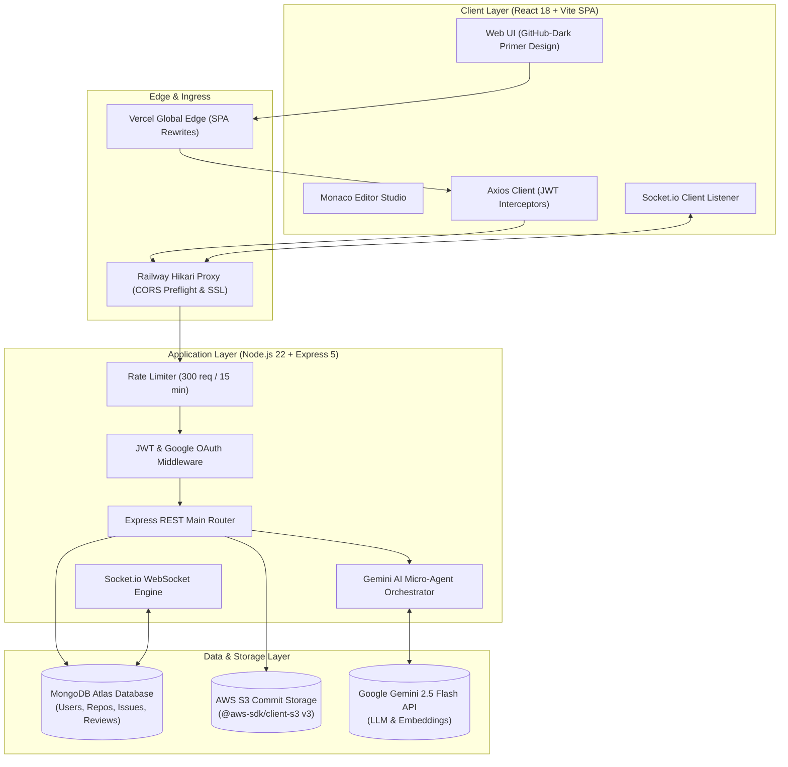

# 🦊 ForjeX — AI-Native Code Hosting & Autonomous Engineering Platform

<p align="center">
  
</p>

<p align="center">
  <strong>An enterprise-grade, AI-native code hosting platform featuring browser-based Monaco Code Studio, custom AWS S3 Git object storage, real-time Socket.io collaboration, and an embedded suite of 11 Autonomous AI Agents powered by Google Gemini.</strong>
</p>

<p align="center">
  <a href="https://forje-x.vercel.app"></a>
  <a href="https://web-production-8073b.up.railway.app/db-status"></a>
  
  
  
  
  
</p>

---

## 📑 Table of Contents
1. [Executive Overview](#-executive-overview)
2. [System Architecture](#-system-architecture)
3. [Key Engineering Pillars](#-key-engineering-pillars)
4. [Autonomous Multi-Agent AI Suite (11 Agents)](#-autonomous-multi-agent-ai-suite-11-agents)
5. [Quality Engineering, Testing & STLC Rigor](#-quality-engineering-testing--stlc-rigor)
6. [Defect Life Cycle & Forensic Bug Case Studies](#-defect-life-cycle--forensic-bug-case-studies)
7. [Tech Stack Matrix](#-tech-stack-matrix)
8. [API Reference](#-api-reference)
9. [Local Development & 1-Click Docker Setup](#-local-development--1-click-docker-setup)
10. [Author & Interview Showcase](#-author--interview-showcase)

---

## 🎯 Executive Overview

**ForjeX** was engineered as a modern, high-performance alternative to GitHub with built-in artificial intelligence. Instead of merely viewing repositories, developers on ForjeX can edit code in a full browser-based Monaco editor, manage versions via a proprietary S3-backed Git CLI, collaborate in real time with WebSocket notifications, and invoke **11 autonomous Gemini-powered AI micro-agents** that write pull requests, explain complex functions, generate Jest unit test suites, run SAST vulnerability audits, and construct AST-level architecture diagrams.

### 🌐 Live Production Deployments
- **Frontend SPA (Vercel)**: [https://forje-x.vercel.app](https://forje-x.vercel.app)
- **Backend API (Railway)**: [https://web-production-8073b.up.railway.app](https://web-production-8073b.up.railway.app)
- **Database & Health Check**: [https://web-production-8073b.up.railway.app/db-status](https://web-production-8073b.up.railway.app/db-status)

---

## 🏗️ System Architecture



---

## ⚡ Key Engineering Pillars

### 1. 💻 VS Code-Grade Monaco Studio
- **Multi-Language Syntax Highlighting**: Syntax parsing across JavaScript, TypeScript, Python, C++, Go, Markdown, and JSON.
- **In-Browser File Editing & Live Commits**: Edit code directly on the web with instant diff tracking and persistent repository saves.
- **AI Sidecar Drawer**: Slide-out assistant drawer for instant function explanations, smart reviews, and documentation generation.

### 2. 📦 Distributed Git Engine on AWS S3 (`.myGit`)
ForjeX features a custom CLI client capable of tracking repositories locally and syncing commits to the cloud:
- `forjex init`: Initializes `.myGit/` repository tracking directory and configuration.
- `forjex add <file>`: Stages modified files into `.myGit/staging/`.
- `forjex commit -m "<msg>"`: Generates cryptographic UUID commits, bundles staged snapshots into `.myGit/commits/<uuid>`, and records timestamps.
- `forjex push`: Uploads packaged commit artifacts to AWS S3 using `@aws-sdk/client-s3` with multipart transfer resilience.
- `forjex pull`: Fetches and extracts remote S3 commits down to local working tree.
- `forjex revert <commitId>`: Restores repository state to any prior commit snapshot.

### 3. 🌐 Real-Time Collaboration & Social Graph
- **WebSocket Event Bus (Socket.io)**: Push notifications for repository stars, user follows, issue creation, and automated code review completion.
- **Discover Hub (`/discover`)**: Explore public codebases filtered by programming languages and search developer profiles.
- **Collaborate Hub (`/collaborate`)**: Aggregates community issues tagged with `good-first-issue`, `bug`, or `help-wanted`.
- **Dynamic 365-Day Activity Heatmap**: GitHub-style SVG contribution grid calculated from real repository edits, stars, and commits.

---

## 🧠 Autonomous Multi-Agent AI Suite (11 Agents)

ForjeX integrates **11 specialized autonomous agents** built on Google's `gemini-2.5-flash` model:

| # | Agent Name | Role & Architecture | Output |
|:--|:-----------|:--------------------|:-------|
| 1 | **Autonomous Issue-to-PR Resolver** | Reads issue description and repository file contents; analyzes bug semantics and synthesizes multi-file code patches | Unified git diff patch & auto-generated Pull Request ready for merge |
| 2 | **Architecture Graph Generator** | Parses repository directory structure and imports to extract component dependencies | Visual Mermaid.js system architecture diagram |
| 3 | **Autonomous Test Suite Generator** | Analyzes source code signatures, branches, and edge conditions | Production-ready Jest / Vitest test suite with edge-case mocks |
| 4 | **Agentic Multi-File Refactorer** | Scans cross-file dependencies and applies structural design pattern refactorings | Coordinated multi-file code replacements |
| 5 | **SAST Security Vulnerability Patcher** | Static Application Security Testing scanner for OWASP Top 10 (Injection, XSS, Path Traversal) | Security audit report and automated code remediation patch |
| 6 | **Smart Code Reviewer** | Static code analysis engine evaluating readability, security, and complexity | Categorized review comments and a 0–100 repository health score |
| 7 | **AI Issue Triage Bot** | NLP triage bot inspecting incoming bug reports | Automated label assignment (`bug`, `enhancement`), severity ranking, and triage comment |
| 8 | **Natural Language Code Search** | Semantic codebase search across indexed repository files | Context-aware code snippets and explanation answering natural language queries |
| 9 | **Automated README & Doc Generator** | Codebase summarizer reading project structure and package dependencies | Comprehensive, publication-ready GitHub `README.md` |
| 10 | **Commit Intelligence Assistant** | Diff analyzer evaluating staged changes | Conventional Commit messages (`feat:`, `fix:`, `chore:`) and changelogs |
| 11 | **Code Explainer Sidecar** | Educational assistant with selectable complexity tiers | Beginner (ELI5) to Senior SDE architectural breakdowns |

---

## 🛡️ Quality Engineering, Testing & STLC Rigor

As an engineering flagship, ForjeX was built following strict **SDLC (Software Development Life Cycle)** and **STLC (Software Testing Life Cycle)** principles:

### 1. The ForjeX Testing Pyramid
```
          /\
         /  \        End-to-End Testing (Cypress / Playwright)
        / E2E\       User registration, repo creation, file upload, issue flow
       /------\
      /        \     Integration Testing (Supertest & Jest)
     /Integrat. \    API route chaining, DB readyState, JWT validation, S3 upload
    /------------\
   /              \  Unit & Boundary Testing (Jest / Vitest)
  /   Unit Tests   \ Validation logic, username collisions, token decoding
 /------------------\
/ Security & Sanity  \ SAST static scan, /db-status health probes, CORS check
----------------------
```

### 2. Testing Levels Implemented

#### A. Smoke & Sanity Testing
- **Health Probes**: Automated `GET /db-status` probe verifying MongoDB Atlas connection state (`0: Disconnected, 1: Connected, 2: Connecting`).
- **CORS Sanity Check**: `GET /cors-check` verifying origin reflection and preflight credentials before client requests are dispatched.

#### B. Functional Testing
- **Authentication**: Validation of email format, username uniqueness, password hashing (`bcryptjs` 10 rounds), and Google OAuth token signature exchange.
- **Repository Management**: CRUD operations on public and private repositories, multi-file directory uploads via `multer`, and ZIP downloads.
- **Issue Tracking**: Opening, updating, status toggling (`open` / `closed`), and threaded comment deletion.

#### C. Integration Testing
- **Cross-Component Flow**: Client (React SPA) ➔ Ingress Proxy (Railway Hikari) ➔ Auth Middleware ➔ Express Controller ➔ MongoDB Atlas ➔ Real-Time Notification Socket.
- **Storage Integration**: Seamless file streaming from client multipart requests to local workspace disk and remote AWS S3 object storage.

#### D. Boundary & Negative Testing
- **Empty & Malformed Payloads**: Handled with explicit 400 Bad Request responses and descriptive field-level error messages.
- **Boundary Limits**: Username lengths enforced between 2 and 39 characters; password length validation enforced on both client and server.
- **Username Collision Resistance**: Automatic numerical suffix generator (`user4912`) ensuring Google OAuth logins never fail due to duplicate names.

#### E. Security & Vulnerability Testing
- **Path Traversal Guard**: Enforced `absolutePath.startsWith(uploadsRoot)` across all file read, update, and deletion controllers.
- **Cryptographic Token Verification**: Enforced Google OAuth ID token verification via `client.verifyIdToken({ audience })` rather than unsafe unverified payload decodes.
- **Rate Limiting**: `express-rate-limit` configured at 300 requests per 15-minute window per IP to prevent brute-force attacks and denial-of-service.

---

## 🐞 Defect Life Cycle & Forensic Bug Case Studies

During development and staging, several critical distributed-systems defects were discovered, logged, forensically debugged, and resolved:

```
[Defect Identified] ➔ [Root-Cause Analysis] ➔ [Isolation & Reproduction] ➔ [Code Remediation] ➔ [Automated Re-Testing] ➔ [Closed]
```

### Case Study 1: Edge Proxy CORS Origin Mismatch
- **Symptoms**: Preflight `OPTIONS` requests failed with: `The 'Access-Control-Allow-Origin' header has a value 'https://forjex.vercel.app' that is not equal to the supplied origin 'https://forje-x.vercel.app'`.
- **Root Cause**: Railway's Hikari edge proxy server intercepts `OPTIONS` requests before Express and synthesizes CORS headers based on the dashboard environment variable. A single missing hyphen (`forjex` vs `forje-x`) caused edge preflight rejections.
- **Fix & Verification**: Standardized Express CORS with dynamic origin matching, updated the dashboard variable, and built an automated node verification script confirming HTTP 204 with matching origin.

### Case Study 2: Dual React Instance Dispatcher Null Crash
- **Symptoms**: Browser console crashed with: `TypeError: Cannot read properties of null (reading 'useState')` inside UI library bundles.
- **Root Cause**: Multiple dependencies (`@primer/react`, `@monaco-editor/react`, `styled-components`) bundled duplicate copies of React. When hooks executed, `ReactCurrentDispatcher.current` was `null`.
- **Fix & Verification**: Configured `resolve.dedupe: ["react", "react-dom"]` and `optimizeDeps.include: ["react", "react-dom"]` in `vite.config.js`. Verified clean 0-warning Rollup build across 462 modules.

### Case Study 3: Google OAuth ID Token Signature Bypass
- **Symptoms**: Security audit revealed `jwt.decode(token)` was being executed as the primary auth step.
- **Root Cause**: `jwt.decode()` merely reads base64 JSON payload without verifying the asymmetric cryptographic signature against Google's public keys.
- **Fix & Verification**: Refactored `googleAuth.router.js` to strictly enforce `OAuth2Client.verifyIdToken({ idToken, audience: clientId })` as the mandatory path, rejecting any tampered or unverified tokens.

### Case Study 4: Docker Container Initialization Crash
- **Symptoms**: Railway build failed during container startup with: `The executable 'cd' could not be found`.
- **Root Cause**: The startup script executed `cd backend && npm start`. In lightweight Linux containers, `cd` is a shell builtin, not a standalone binary executable in `/bin`.
- **Fix & Verification**: Replaced start command with direct binary invocation: `node backend/index.js start`. Container starts cleanly in under 2 seconds.

---

## 🛠️ Tech Stack Matrix

| Area | Technology | Version | Purpose |
|:-----|:-----------|:--------|:--------|
| **Frontend Core** | React | `18.3.1` | Component-driven Single Page Application |
| **Build Tool** | Vite | `7.3.1` | Instant HMR and optimized Rollup production bundler |
| **Code Editor** | Monaco Editor | `^4.7.0` | Browser-based VS Code editing engine |
| **UI Components** | GitHub Primer | `^35.27.0` | GitHub-standard design system and accessibility |
| **Backend Runtime**| Node.js | `>=22.0.0` | High-throughput asynchronous JavaScript runtime |
| **Web Framework** | Express | `^5.2.1` | REST API routing and middleware pipeline |
| **Real-Time Web** | Socket.io | `^4.8.3` | Bidirectional WebSocket notification engine |
| **Database** | MongoDB Atlas | `8.21.1` (Mongoose)| Cloud document database with compound indexing |
| **Cloud Storage** | AWS S3 | `^3.975.0` | Object storage for commit archives and snapshots |
| **AI LLM Engine** | Google Gemini | `^2.15.0` | `gemini-2.5-flash` model for multi-agent workflows |
| **Authentication** | JWT & Google OAuth | `jsonwebtoken ^9.0.3` | Asymmetric Google ID tokens and signed HS256 app JWTs |
| **Security** | BCrypt & RateLimit | `bcryptjs ^3.0.3` | Salted password hashing and IP rate limiting |

---

## 📡 API Reference

### 🔐 Authentication (`/` & `/auth`)
- `POST /signup` — Register new user with username, email, and password.
- `POST /login` — Authenticate existing user; returns 7-day signed JWT.
- `POST /auth/google` — Exchange verified Google ID token for authenticated session.

### 📁 Repository Management (`/repo`)
- `POST /repo/create` — Create public or private repository.
- `GET /repo/all` — List all accessible repositories.
- `GET /repo/:id` — Fetch repository metadata, file tree, and star count.
- `GET /repo/:id/file?path=<path>` — Fetch raw contents of a specific file.
- `PUT /repo/:id/file` — Update file content directly via Monaco Editor.
- `DELETE /repo/:id/file` — Securely delete file with path-traversal validation.
- `POST /repo/:id/upload` — Upload files or folder structures (multipart/form-data).
- `POST /repo/:id/star` — Toggle star status for the authenticated user.
- `GET /repo/:id/download` — Download full repository as a `.zip` archive.

### 🐛 Issue Tracking (`/issue`)
- `POST /issue/create/:id` — Open new issue on repository (collaborator open-access).
- `GET /issue/all/:id` — Retrieve all open/closed issues for a repository.
- `GET /issue/:id` — Fetch issue details, triage labels, and discussion thread.
- `PUT /issue/update/:id` — Toggle issue status between open and closed.
- `POST /issue/:id/comment` — Post comment on an issue discussion thread.
- `DELETE /issue/:id/comment/:commentId` — Delete comment (author or repo owner).

### 🤖 Autonomous AI Micro-Agents (`/ai`)
- `POST /ai/explain` — Analyze code snippet with selectable ELI5 or Senior explanations.
- `POST /ai/review/:repoId` — Full repository code review with 0–100 health index.
- `POST /ai/triage/:issueId` — Automated bug triage, severity score, and label assignment.
- `POST /ai/agent/resolve-issue/:issueId` — Autonomous Issue-to-PR code resolver agent.
- `GET  /ai/architecture/:repoId` — Generate Mermaid.js system architecture diagram.
- `POST /ai/test/generate` — Generate Jest unit test suite with edge-case mocks.
- `POST /ai/refactor/:repoId` — Perform multi-file code refactoring.
- `POST /ai/security/patch/:repoId` — SAST OWASP security audit and automated patch.
- `POST /ai/search/:repoId` — Natural language semantic code search.
- `POST /ai/docs/:repoId/readme` — Auto-generate comprehensive repository `README.md`.
- `POST /ai/commit/message` — Analyze diff and generate Conventional Commit message.

### 🩺 System Diagnostics (`/`)
- `GET /db-status` — MongoDB Atlas live connection state and error diagnostics.
- `GET /cors-check` — Origin reflection and CORS preflight verification.

---

## 🚀 Local Development & 1-Click Docker Setup

### Option 1: 1-Click Docker Compose (Recommended)
Spin up MongoDB Atlas simulator, Backend, and Frontend in a single command:
```bash
docker-compose up --build
```
- Frontend: `http://localhost:5173`
- Backend API: `http://localhost:3000`
- MongoDB: `mongodb://localhost:27017/forjeX`

---

### Option 2: Manual Local Setup

#### 1. Clone Repository
```bash
git clone https://github.com/kiran-p-16/ForjeX.git
cd ForjeX
```

#### 2. Install Monorepo Dependencies
```bash
# Install root, backend, and frontend packages via npm workspaces
npm install
```

#### 3. Configure Environment Variables
Create `backend/.env`:
```env
PORT=3000
NODE_ENV=development
MONGODB_URI=mongodb+srv://<username>:<password>@cluster0.mongodb.net/forjeX?retryWrites=true&w=majority
JWT_SECRET_KEY=forjex_super_secret_jwt_key_2026_x987
GEMINI_API_KEY=AIzaSy...your_gemini_api_key
GOOGLE_CLIENT_ID=1081356031017-n1r83d9h52nj38dqds7o3937gjurkg4v.apps.googleusercontent.com
FRONTEND_URL=http://localhost:5173
```

Create `frontend/.env`:
```env
VITE_API_URL=http://localhost:3000
VITE_GOOGLE_CLIENT_ID=1081356031017-n1r83d9h52nj38dqds7o3937gjurkg4v.apps.googleusercontent.com
```

#### 4. Run Development Servers
```bash
# Terminal 1: Backend
npm run dev:backend

# Terminal 2: Frontend
npm run dev:frontend
```

---

## 👨‍💻 Author & Interview Showcase

- **Author**: Kiran Kumar P
- **Role Candidate**: Associate Software Test Engineer (STE)
- **Live Platform**: [https://forje-x.vercel.app](https://forje-x.vercel.app)
- **GitHub Repository**: [https://github.com/kiran-p-16/ForjeX](https://github.com/kiran-p-16/ForjeX)

> *"Quality is not an afterthought; it is built into the architecture from day one through automated sanity checks, defensive input validation, cryptographic verification, and comprehensive testing lifecycles."*

---

## 📜 License
Licensed under the [ISC License](LICENSE).
